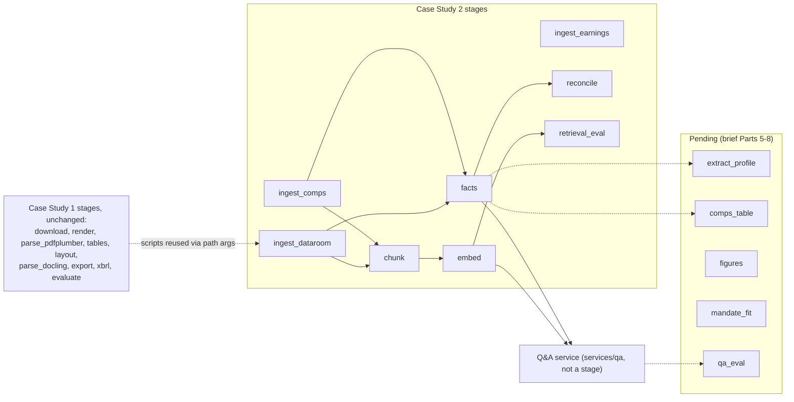

# Project LANTERN — Case Study 2 (personal)

A private-equity screening pipeline: it reads a seller's data room and the public filings of comparable companies,
builds a fact store where every number carries a source tier and a citation, flags where management's claims disagree
with the seller's own financials, and answers questions with cited, tier-labelled numbers that are checked by a
numeric linter.

This repository continues **Case Study 1**, which was team work (credited [below](#case-study-1-base-team-work)).
**Case Study 2 Parts 0–4** are this repository's own work. It follows the DAMG 7245 Case Study 2 brief but is a
personal project, not a course submission.

**The data room is synthetic** (see [Synthetic data](#synthetic-data)).

## Contents

- [Architecture: what Case Study 2 adds](#architecture-what-case-study-2-adds)
- [Status by Part](#status-by-part)
- [Key results](#key-results)
- [Synthetic data](#synthetic-data)
- [Replay reproduction](#replay-reproduction)
- [DVC remote access](#dvc-remote-access)
- [Expected run times](#expected-run-times)
- [Known issues and limitations](#known-issues-and-limitations)
- [Generative-AI declaration](#generative-ai-declaration)
- [Case Study 1 base (team work)](#case-study-1-base-team-work)

## Architecture: what Case Study 2 adds

Case Study 1 parsed two Apple 10-K filings into provenance-tagged records and validated their numbers against XBRL.
Case Study 2 keeps those stages unchanged and reuses them through their path arguments. It adds:

- **Value-tiered ingestion.** Comparables' numbers come from Inline XBRL (tier 1). Docling text is used only for
  10-K Items 1, 1A and 7. Data-room PDFs, scans, the spreadsheet and the transcript go through the CS1 parsers.
  Records use the `lantern/2.0` schema (`deal_id`, `source_type`, `tier`, `citation`, `lineage`).
- **A tiered fact store** (`data/facts/facts.duckdb`). It holds XBRL facts (tier 1) and seller-spreadsheet facts
  (tier 3), each with a citation, plus management claims (tier 4) extracted by an LLM.
- **Reconciliation** of management claims against the seller's financials.
- **Chunking, embeddings and hybrid retrieval** (BM25 + dense, reciprocal rank fusion). Every query is
  scope-filtered in the vector store.
- **A grounded answering service.** Every number must reference a fact, a calculator output or a labelled claim,
  and must pass a numeric linter.
- **Replay.** Every LLM and embedding call goes through `src/llm/client.py`, whose caches are tracked by DVC, so the
  pipeline reruns offline with `LANTERN_LLM_MODE=replay`.



The brief's stage names are used exactly (`dvc.yaml`). The Q&A dev run is a script (`python -m src.qa.run_dev`), not
a stage; the brief's `qa_eval` stage belongs to Part 8.

## Status by Part

| Part | Status | Code | Reports and outputs |
|---|---|---|---|
| 0 Corpus expansion and value-tiered ingestion | **partial**: `ingest_comps`, `ingest_earnings`, `ingest_dataroom` done; the `ingest_web` stage and the scale-up comparison against CS1 are pending | `src/ingest/` | `reports/comps_selection.md`, `reports/scale_up.md` (routing policy), `data/bench/cs2/` |
| 1 Fact store, tiers, reconciliation | **partial**: done on Kestrel; `outputs/reconcile/deal_a.jsonl` and `deal_b.jsonl` wait for Deal A/B | `src/facts/`, `config/metrics_vocab.yaml` | `reports/reconciliation.md`, `data/facts/` |
| 2 Chunking, embedding, indexing | **done** | `src/chunk.py`, `src/index.py`, `src/retrieve.py` | `reports/retrieval_design.md` |
| 3 Retrieval evaluation and isolation | **partial**: metrics, choice and fixture isolation test done; the full-index isolation run waits for Deal A/B | `src/retrieval_eval.py`, `tests/test_retrieval.py`, `data/eval/qrels.jsonl` | `reports/retrieval_eval.md`, `reports/retrieval_eval.json` |
| 4 Grounded answering service | **done** on the dev suite; the variant suite is pending | `services/qa/`, `src/qa/`, `src/calc/`, `deploy/compose.yaml` | `outputs/qa/dev.jsonl`, `outputs/qa/dev_summary.json` |
| 5 Structured profile vs RAG, screening memo | pending | — | — |
| 6 Comps, figures, chart reads | pending (only the minimal calculator Part 4 needs exists, in `src/calc/`) | — | — |
| 7 Mandate-fit scoring | pending | — | — |
| 8 Evaluation, economics, replay | pending | — | — |

Also pending:
- Data: Deal A and Deal B data rooms, the synthetic website, and the Q&A variant suite (`evals/tasks/variant.jsonl`).
- Docs: a CS2 Codelab and demo video (not made).

## Key results

| Result | Value | Source |
|---|---|---|
| Facts in the store | 20,825, of which 63 from the Kestrel spreadsheet | `data/facts/build_log.json` → `totals` |
| Management claims extracted (tier 4) | 18 | `data/facts/build_log.json` → `totals.claims` |
| iXBRL citations whose tag text gives back the stored value | 18,784 resolve, 0 mismatched, 1,978 not numeric (dashes, words) | `data/facts/build_log.json` → `totals` |
| XBRL facts cross-checked against EDGAR companyfacts | 7,625 compared, 7,625 matched, 0 mismatched | `data/facts/build_log.json` → `totals` |
| Vocabulary statement metrics per comparable (brief Part 0 asks ≥ 8) | 13–19 across the 8 comparables | `data/facts/build_log.json` → `comps.*.statement_metrics_with_facts` |
| Reconciliation on Kestrel's five trap categories | recall (caught) 5/5, recall (exact status) 4/5, precision 5/5 | `reports/reconciliation.md` |
| Retrieval strategy chosen | block chunks, 200 tokens, no overlap, open embedding model (`block-200-0-open`) | `reports/retrieval_eval.json`, `params.yaml` → `retrieval` |
| Its hybrid nDCG@10 / recall@10 (60 queries) | 0.3909 / 0.5343 (runner-up: the hosted model on the same chunks, nDCG@10 0.3871) | `reports/retrieval_eval.json` |
| Isolation test, filter removed | fails with 502 leaks of the committed fixture's toy deal_b across the 60 queries (it passes with the filter); no real Deal B exists yet | `reports/retrieval_eval.md` → Isolation |
| Total LLM and embedding spend | $0.256925: claims extraction $0.02064, embeddings $0.042344, Q&A $0.193941 | `logs/cost_ledger.jsonl` (sum of `usd` by `stage`) |

**Q&A acceptance on the dev suite** (brief Part 4). Source: `outputs/qa/dev_summary.json`. The suite has 39 tasks, 32
of them answerable (`evals/tasks/dev.jsonl`).

| Brief acceptance | Result |
|---|---|
| Every number linted-and-resolved, or its claim dropped | 50 of 50 numbers resolved; 3 answers had a claim dropped |
| Linter precision on ≥ 50 labelled numbers | 1.0 (59 true positives, 0 false positives, 108 labelled spans) |
| Every citation resolves to an existing block | 71 of 71 |
| …whose text contains the cited number | 51 of 51 |
| Answer coverage (answerable questions not abstained) | 32 of 32 |
| Answer status | 29 answered, 3 partially abstained, 7 not disclosed |

Retrieval quality is modest. Recall@20 of the chosen strategy is 0.62 (`reports/retrieval_eval.json`), so about 4 in
10 relevant blocks are not among the first 20 returned. `reports/retrieval_eval.md` gives the diagnosis.

## Synthetic data

The brief's instructor-provided data never arrived, so this project uses **synthetic** data in its place:

- **A separate private generator** produces it, outside this repository. It is seeded and config-driven, and its
  configs reveal the traps, which is why it is kept private.
- **Its outputs land at the brief's paths** and are tracked with DVC, never Git: `data/dataroom/kestrel/raw`,
  `data/dataroom/kestrel/answer_key.yaml`, `data/dataroom/canaries_visible.json`, `data/dataroom/variant.json`,
  `evals/tasks`.
- **The data rooms contain planted traps**: claims that disagree with the financials, run-rate and period tricks,
  concentration claims, add-backs. Deal B is specified with planted canary strings for isolation tests.
- **Kestrel, the practice deal, has a public answer key**, as in the brief.
- **Deal A and Deal B answer keys are hidden** outside the repository, in neither Git nor DVC. They are not to be
  opened before final evaluation. Deal A and Deal B have not been generated yet.
- **The comparables are real companies**, with real SEC EDGAR filings: BILL, FLYW, PAYO, FOUR, TOST, GPN, PYPL, XYZ
  (`params.yaml` → `comps.tickers`, selection in `reports/comps_selection.md`).

## Replay reproduction

The brief's reproducibility contract (Section 7), adapted to the stages that exist:

```bash
git clone https://github.com/prekshapraveen2502/project-lantern.git lantern && cd lantern
git checkout main                      # the brief's cs2-submission tag does not exist (not a course submission)
python -m venv .venv && source .venv/bin/activate
pip install -r requirements.txt
dvc pull                               # needs read access to the private remote (see below)
export LANTERN_LLM_MODE=replay
dvc repro                              # every stage, offline, from the LLM/embedding caches
dvc metrics show
python -m src.qa.run_dev               # Part 4 dev answers and acceptance checks (not a DVC stage)
pytest -q
# lantern-check cs2 --no-network       # the course checker is not available to this repository
```

What to expect:

- After `dvc pull`, `dvc repro` skips every stage, because `dvc.lock` matches the pulled data. Run with
  `LANTERN_LLM_MODE=replay` and no API key, `dvc status` and `dvc repro --dry` both report "Data and pipelines are
  up to date".
- `python -m src.qa.run_dev` in replay rewrites `outputs/qa/` byte for byte from `data/qa_cache` and adds no rows to
  `logs/cost_ledger.jsonl`. A question that is not in the cache fails, rather than calling a model.
- `pytest -q` skips the full-index isolation test, which waits for Deal A/B in the index.
- The answering service also runs in replay in a container:
  ```bash
  docker compose -f deploy/compose.yaml up --build
  curl localhost:8000/health
  ```
  The image contains code and params only; data is mounted read-only, and no key is passed in.

What has and has not been verified:

- **Verified, stage by stage:** replay for `facts` (claims), `embed`, `retrieval_eval` and the Q&A dev run, each
  with no API key. The `facts` and Q&A replays also ran with the network blocked.
- **Not verified:** the whole contract on a clean machine, start to finish.

## DVC remote access

The DVC remote is a **private** S3 bucket: `lantern` = `s3://project-lantern-dvc-preksha/dvc` (`.dvc/config`).

- `dvc pull` needs read credentials, which are available on request.
- Credentials go in `.dvc/config.local`, which is gitignored:

  ```bash
  dvc remote modify --local lantern access_key_id <KEY_ID>
  dvc remote modify --local lantern secret_access_key <SECRET>
  ```

The brief asks that reproduction need no personal cloud credentials; this repository does not meet that yet.

## Expected run times

After `dvc pull`, every stage is skipped in seconds.

**Case Study 2 stages**, from `data/bench/cs2/<stage>.csv`. Times are the sum of `seconds` over the items of the most
recent run, on Darwin arm64, 10 threads, 16 GiB, Python 3.11.17 (the CSVs' `machine` column):

| Stage | Latest run | Items |
|---|---|---|
| `ingest_comps` | 58.2 s | 8 comparables |
| `ingest_earnings` | 14.3 s | 8 comparables |
| `ingest_dataroom` | 26.9 s | 5 items (Kestrel) |
| `facts` | 12.2 s | 10 items |
| `embed` | 17.9 s | 12 collections |
| `retrieval_eval` | per-query latency only: hybrid p50 144.87–203.86 ms by collection | 12 collections |
| `chunk`, `reconcile` | not timed | — |

The CSVs do not record whether a run was in record or replay mode.

**Case Study 1 stages:** measured on the CS1 team's laptop; see `reports/benchmarks.md`. From scratch, `parse_docling`
is the slow one, at about 27 minutes for the two filings (`data/docling/timing.csv`).

## Known issues and limitations

**Data and scope**
- Deal A, Deal B, the synthetic website and the variant suite do not exist yet. So the reconcile outputs for Deal A/B,
  the `ingest_web` stage, the full-index isolation run and every Part 5–8 deliverable are pending.
- The DVC remote is private (above).
- `.github/workflows/smoke.yml` exists, but no workflow run is recorded on this repository (`gh run list` returns
  none), so there is no CI.

**Fact store and reconciliation** (`reports/reconciliation.md`)
- T-NRR is caught, but our status (`period_mismatch`, for "Q4 FY2025, annualized") differs from the key's
  (`discrepancy`).
- T-ADDBACK comes out as `definition_mismatch`: the claimed 15.8 equals the management-adjusted QoE fact. The key
  expects `discrepancy`.
- The transcript's "fourteen quota-carrying reps" was mapped to headcount. It is harmless here (`no_fact`).
- In `params.yaml` → `llm.prices`, `text-embedding-3-small` was checked on 2026-11-06; `gpt-4.1-mini` is not yet
  checked against the provider's page. Unit economics (Part 8) will read these prices.
- `data/rendered/manifest.csv` (a CS1 output) is left unchanged by decision (DECISIONS 2026-11-06); the per-deal
  `data/dataroom/{deal}/export/manifest.csv` carries `deal_id` and `source_type`.
- CS1's `xbrl` stage has a weakness when offline: with an empty taxonomy cache, Arelle loads only part of a
  filing's facts. CS2's `facts` stage avoids this with the DVC-tracked `data/arelle_cache` and a guard: loaded
  numeric facts must equal the filing's `ix:nonFraction` tags. CS1 is left unchanged.

**Retrieval** (`reports/retrieval_eval.md`)
- nDCG@10 is modest; the report diagnoses why, by category.
- The qrels were found by keyword search, which can understate dense retrieval.
- Several categories have only 5–11 queries.

**Q&A** (`outputs/qa/dev.jsonl`, `outputs/qa/dev_summary.json`)
- K14 asks how much Kestrel's net revenue grew. The answer leads with the CIM's 31% (labelled unverified) and never
  states the 21.8% growth calc from the seller financials. It passes the linter but is likely scored wrong in
  Part 8.
- P09's second claim says net cash used in investing "increased by -$2,998 million". The values pass the linter, but
  the sentence is misleading.
- `data/qa_cache` keeps entries from a superseded first dev run that nothing uses any more.
- The fact matcher for XBRL concept names was tuned on the dev suite; the variant suite is held out.
- Linter precision (1.0) was measured on labels that were in view while the rules were written, so it is not a
  held-out figure.
- Numeric accuracy against the expected answers is not measured yet (Part 8).

## Generative-AI declaration

- **Code**: written with Claude Code (Anthropic) under my direction and review.
- **Drafts I accepted**: the design review, the retrieval qrels, the Q&A dev suite and the linter's labelled
  numbers were drafted with Claude, then reviewed and accepted by me.
- **Models inside the pipeline**, all called through `src/llm/client.py` with cached, replayable calls:
  - `gpt-4.1-mini` extracts management claims and answers questions.
  - `text-embedding-3-small` (hosted) and `BAAI/bge-small-en-v1.5` (open, run locally) compute embeddings.
- **Also written with Claude**: the synthetic data generator (outside this repo) and this README.

## Case Study 1 base (team work)

Case Study 1 (DAMG 7245, Fall 2026, Team 1) was built by **Preksha Praveen, Pradyumna Reddy Cherla and Pranav
Waghmare**, in [BigDataIA-Fall-26-Team-1/lantern](https://github.com/BigDataIA-Fall-26-Team-1/lantern).

- **What it did:** downloaded and rendered two Apple 10-K filings; extracted text (pdfplumber with Tesseract OCR),
  tables and layout blocks; ran Docling as a second path; wrote provenance-tagged JSONL; validated statement numbers
  against XBRL; compared against AWS Textract.
- **Its stages** remain in `dvc.yaml` unchanged: `download`, `render`, `parse_pdfplumber`, `tables`, `layout`,
  `parse_docling`, `export`, `xbrl`, `evaluate`, `parse_fixtures`.
- **Its reports** are in `reports/`: `eval.md`, `metrics.json`, `xbrl.md`, `benchmarks.md`, `docling_comparison.md`,
  `build_vs_buy.md`, `format_decision.md`, `tables_method.md`, `layout_audit.md`, `ground_truth_conventions.md`.
- **Its app** (`app/`, `deploy/lantern-*.service`) is a read-only viewer over the CS1 outputs.
- **As delivered for CS1** (not maintained here):
  - [Codelab](https://bigdataia-fall-26-team-1.github.io/lantern/lantern-case-study-1/)
  - [demo video](https://drive.google.com/file/d/1lCoqemP_CqSJkEtIJpjWF-UANFHNMA95/view?usp=drive_link)
  - a Streamlit app deployed on EC2
